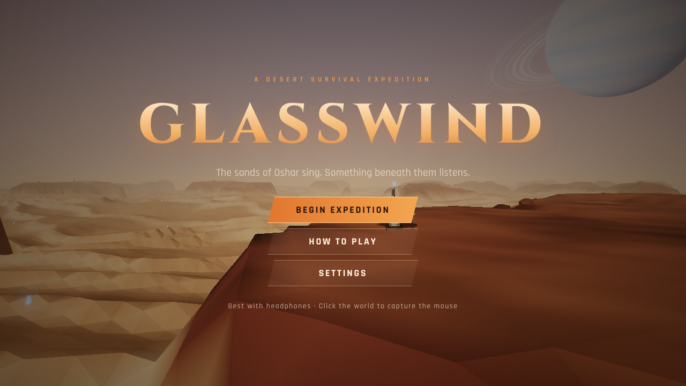
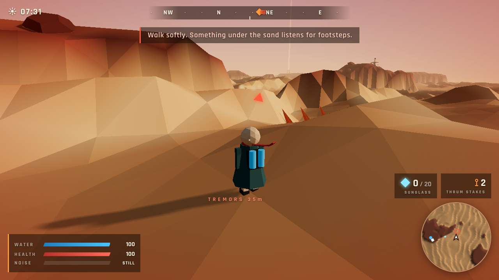
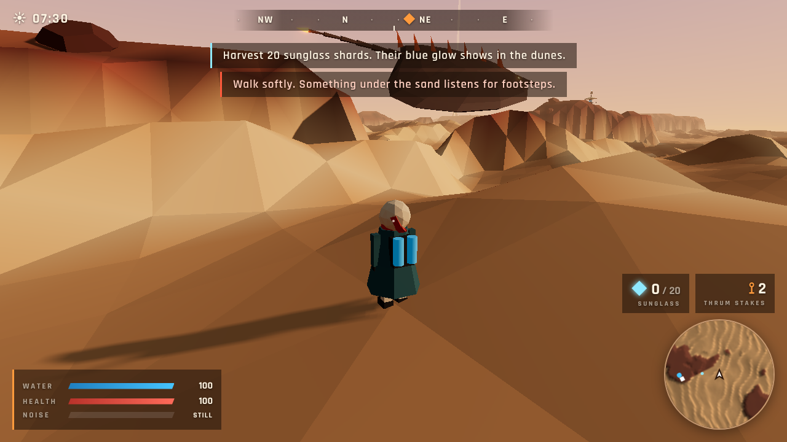
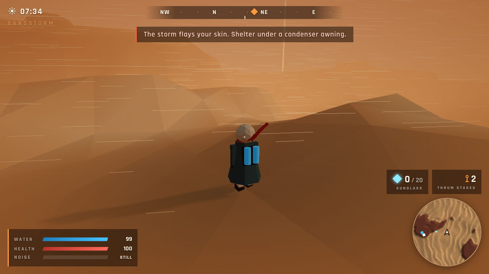
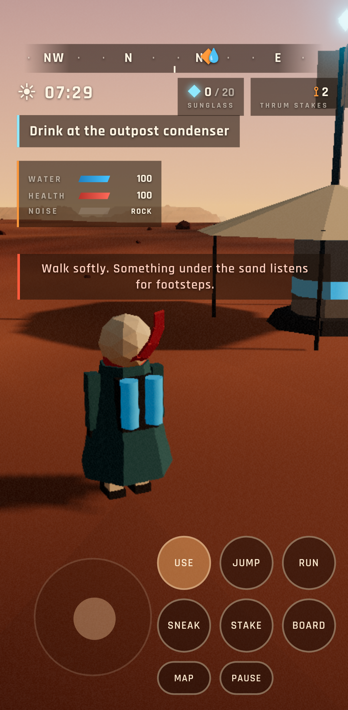

# Glasswind

*The sands of Oshar sing. Something beneath them listens.*

An original low-poly, open-world desert survival game that runs in the browser, built with **Three.js** and **Vite**. The terrain, models, sky and sound effects are generated in code. The only external assets are two music tracks (see Credits).



## The game

You are a glass-runner dropped on Oshar, a desert world under a ringed gas giant. Harvest **15 shards of sunglass** (the glowing blue crystals in open sand), then reach the **signal beacon** and call your lift before the desert claims you.

- **No water to manage.** You heal on your own a few seconds after a hit, and fully at dew condensers on the rock mesas. Supply caches hold med kits and thrum stakes.
- **The Veil Ray** is a ray the size of a cathedral that swims beneath the dunes and hunts by **vibration**. Footsteps, harvesting and above all the skimmer's engine draw it in. When the ground boils, sprint. A hit hurts but won't kill you outright, and it cannot reach you on rock.
- **Thrum stakes** pound the sand for 16 seconds and lure it away.
- **Sand-skimmer**: fast, but loud. Once it has power, press **R** and it flies to you from anywhere.
- **Day and night**: a 7-minute cycle. Nights are dark, and the ray is bolder.
- **Sandstorms** blind you and hurt you in the open, but they also muffle your noise.
- **A story in four chapters**: restart the outpost condenser, pull a power cell from a crashed skimmer, read the five echo tablets in the ruins, and hold the beacon for 45 seconds while the lift comes down.
- **Workbench upgrades** at condensers: trade sunglass for glass plating, hush wraps, a sealed cloak, a stake satchel, engine baffles or tremor sense.
- **Autosave**: progress saves every 20 seconds and when you leave, and **Continue** on the menu picks it up.
- **Plays anywhere**: keyboard and mouse, gamepad, or touch controls on phones and tablets. Adaptive resolution keeps the frame rate steady on slower devices.

| | |
|---|---|
|  |  |
|  |  |



## Controls

| Key | Action |
|---|---|
| W A S D | Move / steer |
| Mouse | Look (click to capture; right-drag also works) |
| Shift | Sprint / boost |
| C or Ctrl | Sneak (quiet) |
| Space | Jump |
| E (hold) | Harvest, drink, open, call the lift |
| F | Board or leave the skimmer |
| Q | Plant a thrum stake |
| R | Call the skimmer to you |
| M | Large map |
| Esc | Pause |

**Gamepad:** left stick moves, right stick looks, A jump or drift, X use, Y board, B sneak, RT sprint or boost, LB stake, RB call skimmer, Back map, Start pause.

**Touch:** drag the left side to move and the right side to look; on-screen buttons cover the rest.

## Run it

```bash
npm install
npm run dev      # http://localhost:5173
npm run build    # static site in dist/
```

The build is a plain static site with relative paths, so `dist/` can be hosted anywhere. A GitHub Pages workflow is included (`.github/workflows/deploy.yml`): enable Pages with source **GitHub Actions** in the repository settings and every push to `main` deploys.

## Code map

| File | What it does |
|---|---|
| `src/terrain.js` | Procedural dunes (asymmetric crests), terraced mesas, height sampling, minimap image |
| `src/sky.js` | Sky shader, sun/moon lighting, stars, ringed planet, day/night palette, storm tint |
| `src/creature.js` | Veil Ray AI: roam, hear, hunt, warn, breach, dive |
| `src/player.js` | Third-person wanderer controller and the hover skimmer |
| `src/models.js` | All low-poly models built from primitives |
| `src/particles.js` | Pooled sand particles and storm streaks |
| `src/audio.js` | Music playback, reactive score, positional (HRTF) effects (Web Audio) |
| `src/touch.js` | Touch joystick and buttons, gamepad polling |
| `src/story.js` | Chapters, echo tablets, workbench upgrades |
| `src/hud.js` | Compass, minimap, toasts, tremor indicator |
| `src/main.js` | World setup, game rules, UI flow and render loop |

## Credits

- Music: "Dune Legacy" by Luminewave and "Dune" by Audioknap, via [Pixabay](https://pixabay.com/music/) under the Pixabay Content License.
- Reactive score, sound design, art and code: made for this project.
