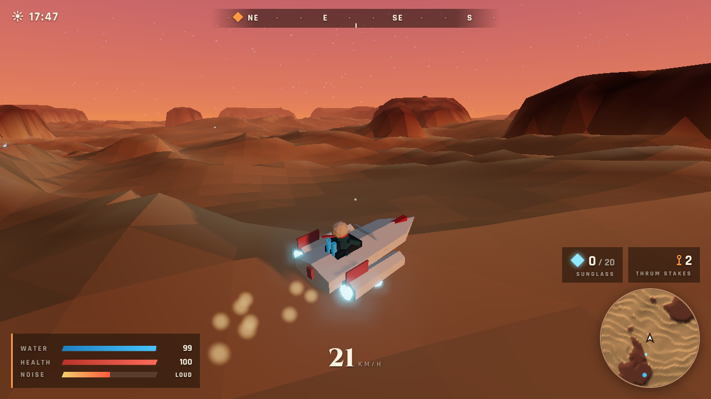

# Glasswind

*The sands of Oshar sing. Something beneath them listens.*

An original low-poly, open-world desert survival game that runs in the browser, built with **Three.js** and **Vite**. There are no external assets: the terrain, models, sky and every sound are generated in code.


## The game

You are a glass-runner dropped on Oshar, a desert world under a ringed gas giant. Harvest **20 shards of sunglass** (the glowing blue crystals in open sand), then reach the **signal beacon** and call your lift before the desert claims you.

- **Water is life.** It drains faster under the midday sun, when you sprint, and in storms. Refill at dew condensers on the rock mesas, or scavenge supply caches.
- **The Veil Ray** is a ray the size of a cathedral that swims beneath the dunes and hunts by **vibration**. Footsteps, harvesting and above all the skimmer's engine draw it in. When the ground boils, sprint. It cannot reach you on rock.
- **Thrum stakes** pound the sand for 16 seconds and lure it away.
- **Sand-skimmer**: fast, but loud. Outrun the ray or lead it straight to you.
- **Day and night**: a 7-minute cycle. Nights are cool and easy on your water but dark.
- **Sandstorms** blind you and hurt you in the open, but they also muffle your noise.

| | |
|---|---|
|  |  |
|  |  |

## Controls

| Key | Action |
|---|---|
| W A S D | Move / steer |
| Mouse | Look (click to capture; right-drag also works) |
| Shift | Sprint / boost |
| C or Ctrl | Sneak (quiet) |
| Space | Jump |
| E (hold) | Harvest, drink, open, call the lift |
| F | Board or leave the skimmer |
| Q | Plant a thrum stake |
| M | Large map |
| Esc | Pause |

## Run it

```bash
npm install
npm run dev      # http://localhost:5173
npm run build    # static site in dist/
```

The build is a plain static site with relative paths, so `dist/` can be hosted anywhere. A GitHub Pages workflow is included (`.github/workflows/deploy.yml`): enable Pages with source **GitHub Actions** in the repository settings and every push to `main` deploys.

## Code map

| File | What it does |
|---|---|
| `src/terrain.js` | Procedural dunes (asymmetric crests), terraced mesas, height sampling, minimap image |
| `src/sky.js` | Sky shader, sun/moon lighting, stars, ringed planet, day/night palette, storm tint |
| `src/creature.js` | Veil Ray AI: roam, hear, hunt, warn, breach, dive |
| `src/player.js` | Third-person wanderer controller and the hover skimmer |
| `src/models.js` | All low-poly models built from primitives |
| `src/particles.js` | Pooled sand particles and storm streaks |
| `src/audio.js` | Synthesized wind, rumble, engine, music and effects (Web Audio) |
| `src/hud.js` | Compass, minimap, toasts, tremor indicator |
| `src/main.js` | World setup, game rules, UI flow and render loop |
